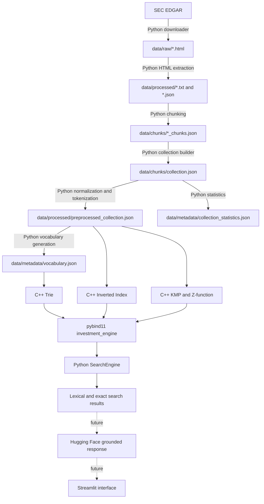

# Developer Handoff

## A. Project Overview

Investment Research Assistant is an Advanced Algorithms university project that applies custom string algorithms and data structures to financial-document retrieval. The current corpus consists of fiscal-year 2024 and 2025 SEC Form 10-K filings for NVIDIA (`NVDA`), AMD (`AMD`), Microsoft (`MSFT`), Apple (`AAPL`), and Alphabet (`GOOGL`).

The intended end-user system will accept a financial research question, retrieve relevant passages from those filings, and eventually use a pretrained language model to produce a grounded answer with supporting sources. A Streamlit interface is part of the intended product described in the root README, but neither the model nor the interface exists yet.

The six academic stages are:

1. **Document Selection and Preparation — complete:** acquire, extract, chunk, consolidate, and describe the filing corpus.
2. **Preprocessing and Data Structures — complete:** normalize and tokenize text; build a vocabulary, Trie, inverted index, and Python/C++ bridge.
3. **Exact String Matching — complete:** implement and integrate KMP and the Z-function; add exact-match ranking, filters, and benchmarks.
4. **Approximate String Matching — not implemented:** Levenshtein distance, n-grams, Jaccard similarity, approximate retrieval, and evaluation.
5. **Hugging Face Integration — not implemented:** model selection, grounded answer generation, citations, and answer evaluation.
6. **Evaluation and Final Comparison — not implemented:** compare retrieval approaches, assess performance and quality, and complete the final academic artifacts.

The project supports educational financial research. It does **not** provide personalized financial, investment, legal, or tax advice, and its filings contain historical rather than real-time market information.

## B. Current Development Status

### Stage 1

- A tracked, validated manifest identifies 10 SEC EDGAR filings: two Form 10-K filings for each of five companies.
- The downloader supplies an SEC-compatible contact `User-Agent`, rate-limits sequential requests, validates responses, and preserves valid existing files.
- HTML extraction removes hidden/non-content elements, preserves readable paragraphs and table rows, and writes plain text plus structured JSON.
- The chunker creates deterministic, metadata-rich passages targeting 250 words with 40 words of overlap while preferring paragraph or sentence boundaries.
- The collection builder validates all expected documents and chunks, rejects duplicate IDs and inconsistent metadata, and writes consolidated collection statistics.

The locally generated dataset contains 10 documents, 5 companies, 2,458 chunks, 493,323 non-overlapping extracted words, and 18,544 extracted paragraphs. Generated data is deliberately excluded from Git.

### Stage 2

- Python performs deterministic Unicode normalization and financial-text tokenization.
- The generated vocabulary contains 14,180 unique normalized tokens and 579,089 token occurrences across 2,458 overlapping chunks.
- A custom C++17 Trie provides insertion, exact lookup, prefix lookup, and lexicographically ordered autocomplete.
- A custom C++17 inverted index provides postings, term frequencies, Boolean AND/OR retrieval, metadata, and raw term-frequency ranking.
- The `investment_engine` pybind11 extension exposes the C++ structures to Python. `src/python/search_engine.py` supplies query normalization and a higher-level API.

### Stage 3

- Custom C++17 KMP and Z-function implementations return every exact match, including overlaps, as zero-based UTF-8 byte offsets.
- `SearchEngine.exact_phrase_search()` supports KMP or Z matching, optional token boundaries, occurrence-count ranking, deterministic ties, top-k, and ticker/fiscal-year filters.
- The benchmark evaluates 17 scenarios and writes 34 algorithm rows. KMP and Z returned identical position vectors for every case.
- On the recorded Apple M5 Pro/Apple Clang 21 run, KMP had the lower median in all 17 cases. Full unfiltered collection scans took approximately 4.404–4.722 ms for KMP and 7.961–8.122 ms for Z. This is an environment-specific observation, not a universal performance ordering.

Current verification passes **56/56 C++ tests** and **83/83 Python tests**. The generated-data integration tests are included in the C++ count because the local vocabulary and preprocessed collection were present when CMake configured the current build.

## C. System Architecture



Python owns network access, HTML parsing, JSON production, normalization/tokenization, pipeline orchestration, query normalization, exact-search candidate selection, metadata filters, and result formatting. C++ owns the educational algorithm and data-structure implementations: Trie traversal, inverted-index operations/ranking, KMP, and the Z-function. pybind11 connects them.

This division makes document work concise and inspectable in Python while preserving from-scratch C++17 implementations for the algorithms being studied. The Python wrapper does not reimplement the C++ search algorithms.

## D. Repository Structure and Component Responsibilities

### Project configuration and documentation

| Path | Responsibility and dependencies |
| --- | --- |
| `README.md` | Project overview, current status, setup, pipeline commands, algorithms, and benchmark summary. It should remain synchronized with later stages. |
| `CMakeLists.txt` | Requires CMake 3.16+, C++17, Python 3.11+ interpreter/development module, and pybind11 discoverable through the selected Python. Builds core libraries, demos, tests, benchmark, and `investment_engine`. Conditionally registers real-data tests if generated files exist at configuration time. |
| `requirements.txt` | Python dependency ranges: PyMuPDF, pybind11, pytest, CMake, Beautiful Soup, and matplotlib. PyMuPDF is installed but the current SEC HTML extractor uses Beautiful Soup rather than PDF parsing. |
| `.gitignore` | Excludes environments, caches, compiled extensions/objects, CMake builds, secrets, raw filings, and generated processed/chunk/metadata files. It retains `.gitkeep` placeholders. |
| `config/document_manifest.json` | Tracked source of truth for the 10 SEC filings. Read by manifest validation, download, extraction selection, chunking selection, and collection validation. |
| `reports/stage1_notes.md` | Stage 1 implementation and data-preparation notes. |
| `reports/stage2_notes.md`, `reports/stage2_validation.md` | Stage 2 design, complexity, dataset validation, and representative retrieval results. |
| `reports/stage3_notes.md`, `reports/stage3_validation.md` | Stage 3 design history, exact-search semantics, benchmark methodology, results, complexity, and limitations. |
| `reports/benchmarks/` | Tracked Stage 3 CSV/JSON measurements and three generated plots. These are benchmark artifacts, not corpus inputs. |

The repository is on `main`, which tracks `origin/main`; the configured remote uses SSH. No repository-specific hooks or unusual local Git settings were found. Generated financial data and compiled extension binaries are intentionally untracked.

### Python modules

| Path | Inputs | Outputs / role | Direct dependencies and interactions |
| --- | --- | --- | --- |
| `src/python/document_manifest.py` | Manifest JSON | Validated immutable `DocumentRecord` objects and selection by ID | Standard library; shared by download, extraction, chunking, and collection building |
| `src/python/download_documents.py` | Manifest records, `SEC_CONTACT_EMAIL`, SEC URLs | `data/raw/<file_stem>.html` | Standard-library HTTP; validates size, company, form, period, and SEC error markers |
| `src/python/extract_text.py` | Raw filing HTML and manifest metadata | `data/processed/<file_stem>.txt` and `.json` | Beautiful Soup; preserves paragraphs/table rows and refuses implausibly small 10-K extractions |
| `src/python/chunk_documents.py` | Extracted document JSON | `data/chunks/<file_stem>_chunks.json` | Standard library and manifest helper; creates ordered overlapping chunks with provenance |
| `src/python/build_collection.py` | Manifest, all processed JSON files, all individual chunk JSON files | `data/chunks/collection.json`, `data/metadata/collection_statistics.json` | Strict cross-file validation; deterministic manifest/position ordering |
| `src/python/preprocess_text.py` | Consolidated collection | `data/processed/preprocessed_collection.json`, `data/metadata/vocabulary.json` | Standard library; exports the normalization/tokenization functions reused by queries |
| `src/python/search_engine.py` | Vocabulary and preprocessed collection | Structured Python search results | Imports compiled `investment_engine` plus preprocessing functions; holds normalized chunk text for exact search |
| `src/python/search_demo.py` | Generated vocabulary/collection and compiled extension | Console examples for Trie, Boolean retrieval, and TF ranking | Uses `SearchEngine` |
| `src/python/exact_search_demo.py` | Same generated files and extension | Console examples for KMP/Z ranking, top-k, punctuation, and filters | Uses `SearchEngine.exact_phrase_search()` |
| `src/python/plot_exact_matching_benchmarks.py` | Benchmark CSV | Three PNG plots in `reports/benchmarks/` | matplotlib; validates required columns and microsecond units |
| `src/python/__init__.py` | None | Marks the Python package | No application behavior |

### C++ modules

| Path | Responsibility and interactions |
| --- | --- |
| `src/cpp/json_reader.{h,cpp}` | Small standard-library JSON reader used by the two generated-data loaders. It is tailored to the required schemas, not intended as a general application JSON library. |
| `src/cpp/vocabulary_loader.{h,cpp}` | Loads `unique_tokens` and `token_frequencies`, verifies counts/frequencies/duplicates, and supplies entries to the Trie. |
| `src/cpp/preprocessed_collection_loader.{h,cpp}` | Loads `total_chunks` and each chunk's ID, document/ticker/year, normalized text, tokens, and optional token count; verifies required values, counts, and unique IDs. |
| `src/cpp/trie.{h,cpp}` | Custom byte-oriented Trie implementation. |
| `src/cpp/inverted_index.{h,cpp}` | Custom token-to-postings index, metadata storage, Boolean retrieval, and TF ranking. |
| `src/cpp/kmp.{h,cpp}` | Custom LPS construction and KMP exact matching/counting. |
| `src/cpp/z_function.{h,cpp}` | Custom Z-array construction and Z-based exact matching/counting. |
| `src/cpp/python_bindings.cpp` | Defines the `investment_engine` module and maps C++ classes/functions into Python names. |
| `src/cpp/*_demo.cpp` | Standalone Trie, index, KMP, and Z demonstrations. KMP/Z demos can load the real preprocessed collection. |
| `src/cpp/exact_matching_benchmark.cpp` | Loads real normalized chunks, verifies KMP/Z equivalence, times production implementations, and writes CSV/JSON. |
| `src/cpp/tests/*_tests.cpp` | Standalone CTest executables for Trie, index, KMP, and Z behavior. |
| `src/cpp/README.md` | C++ subsystem overview, commands, APIs, complexity, and current limitations. |

### Python tests

| Path | Coverage |
| --- | --- |
| `tests/test_document_collection.py` | Manifest/downloader/extraction behavior and real collection integrity. |
| `tests/test_chunk_documents.py` | Chunk sizing, overlap, boundaries, metadata, determinism, and errors. |
| `tests/test_build_collection.py` | Collection/statistics construction and strict validation failures. |
| `tests/test_preprocess_text.py` | Normalization, tokenization, vocabulary production, and real-data consistency. |
| `tests/test_python_bindings.py` | Native Trie/index/KMP/Z bindings, loaders, UTF-8 and embedded-NUL behavior. |
| `tests/test_exact_search.py` | Exact retrieval, candidate/fallback behavior, boundaries, ranking, top-k, filters, and real corpus results. |

## E. Reproducible Environment Setup

Run all commands from the repository root. macOS is the verified platform.

Requirements:

- Python 3.11 or newer; 3.11 or 3.12 is recommended for broad dependency compatibility. The latest verified local build used Python 3.14.7.
- A C++17 compiler. Apple Clang from the Xcode Command Line Tools is verified.
- CMake, installed into the virtual environment from `requirements.txt`.

```bash
# If clang++ is absent, install Apple's tools manually:
xcode-select --install

python3 -m venv .venv
source .venv/bin/activate
python -m pip install --upgrade pip
python -m pip install -r requirements.txt

python --version
python -c "import bs4, cmake, matplotlib, pybind11, pymupdf, pytest; print('Python dependencies OK')"
clang++ --version
cmake --version
```

Configure CMake with the same interpreter that will import the extension:

```bash
cmake -S . -B build \
  -DCMAKE_BUILD_TYPE=Release \
  -DPython_EXECUTABLE="$PWD/.venv/bin/python"
cmake --build build --parallel
```

The compiled extension is placed in `build/python/`. Make it importable without installing it:

```bash
PYTHONPATH=build/python python -c \
  "import investment_engine; print(investment_engine.__doc__)"
```

Run both suites:

```bash
ctest --test-dir build --output-on-failure
PYTHONPATH=build/python python -m pytest tests -q
```

If the virtual environment is not activated, use `.venv/bin/cmake`, `.venv/bin/ctest`, and `.venv/bin/python` explicitly. On the current machine, `ctest` is not globally available but `.venv/bin/ctest` works.

On a different macOS architecture or Python minor version, delete or use a different ignored build directory and rebuild. A `.so` compiled for one Python ABI/architecture is not portable to another. Other Unix-like platforms may work with a C++17 compiler, Python development headers, and the same CMake flow, but only macOS is verified. Windows support and commands are unverified.

Deactivate when finished:

```bash
deactivate
```

## F. Data Reproduction

Raw filings and every generated JSON/text data product are ignored by Git. A fresh clone contains only `.gitkeep` files under `data/`; regenerate the corpus locally before configuring CMake if the real-data CTests should be registered.

SEC requests require a genuine contact address and network access. Follow the SEC's current automated-access requirements, identify the requester, and avoid excessive request rates. Never commit the address.

```bash
source .venv/bin/activate
export SEC_CONTACT_EMAIL="your_real_contact@university.edu"

# 1–2. Validate the manifest and download all 10 official filings.
python src/python/download_documents.py --all

# 3. Produce readable text and structured document JSON.
python src/python/extract_text.py --all

# 4. Produce metadata-rich chunks.
python src/python/chunk_documents.py --all --chunk-size 250 --overlap 40

# 5. Validate and consolidate the collection; write statistics.
python src/python/build_collection.py

# 6–7. Normalize/tokenize chunks and generate the vocabulary.
python src/python/preprocess_text.py \
  --input data/chunks/collection.json \
  --output data/processed/preprocessed_collection.json \
  --vocabulary data/metadata/vocabulary.json

# 8. Inspect expected aggregate statistics.
python - <<'PY'
import json
from pathlib import Path

stats = json.loads(Path("data/metadata/collection_statistics.json").read_text())
vocab = json.loads(Path("data/metadata/vocabulary.json").read_text())
print("documents:", stats["total_documents"])
print("companies:", stats["total_companies"])
print("chunks:", stats["total_chunks"])
print("tokens:", vocab["total_token_occurrences"])
print("unique tokens:", vocab["unique_tokens"])
PY
```

Expected values for the verified inputs and default settings are 10 documents, 5 companies, 2,458 chunks, 579,089 token occurrences, and 14,180 unique normalized tokens. A changed SEC response, manifest, extractor, chunking configuration, or preprocessing policy can legitimately change these values and must be investigated/documented rather than forced.

Output locations:

- `data/raw/*.html`: downloaded source filings.
- `data/processed/*.txt`: readable extracted text.
- `data/processed/<file_stem>.json`: extracted paragraphs and filing metadata.
- `data/chunks/<file_stem>_chunks.json`: per-document chunks.
- `data/chunks/collection.json`: consolidated original-text chunks.
- `data/metadata/collection_statistics.json`: aggregate/per-document counts.
- `data/processed/preprocessed_collection.json`: normalized text and token arrays.
- `data/metadata/vocabulary.json`: global token frequencies and policy metadata.

After regeneration, rerun CMake configuration so conditional real-vocabulary and real-collection tests are discovered.

## G. Data Schemas

Examples below are abbreviated but follow the fields produced and consumed by the current code.

### Document manifest

```json
{
  "manifest_version": 1,
  "documents": [{
    "document_id": "NVDA_2024_10K",
    "company": "NVIDIA Corporation",
    "ticker": "NVDA",
    "cik": "0001045810",
    "fiscal_year": 2024,
    "document_type": "10-K",
    "fiscal_year_end": "2024-01-28",
    "filing_date": "2024-02-21",
    "accession_number": "0001045810-24-000029",
    "primary_document": "nvda-20240128.htm",
    "source_url": "https://www.sec.gov/Archives/.../nvda-20240128.htm",
    "file_stem": "nvidia_2024"
  }]
}
```

The validator requires exactly these document fields, a 10-digit CIK, a valid accession format, ISO dates, Form `10-K`, a safe file stem, and a source URL consistent with the SEC identifiers.

### Extracted financial document

```json
{
  "document_id": "NVDA_2024_10K",
  "company": "NVIDIA Corporation",
  "ticker": "NVDA",
  "fiscal_year": 2024,
  "document_type": "10-K",
  "filing_date": "2024-02-21",
  "fiscal_year_end": "2024-01-28",
  "source_url": "https://www.sec.gov/Archives/...",
  "cik": "0001045810",
  "accession_number": "...",
  "primary_document": "...",
  "file_stem": "nvidia_2024",
  "word_count": 51773,
  "character_count": 345553,
  "paragraphs": [{"paragraph_id": 1, "text": "Table of Contents"}]
}
```

The matching `.txt` contains the paragraph text separated by blank lines and has no JSON metadata.

### Individual chunk file

```json
{
  "document_id": "NVDA_2024_10K",
  "chunk_size": 250,
  "overlap": 40,
  "total_chunks": 258,
  "chunks": [{
    "chunk_id": "NVDA_2024_10K_0001",
    "position": 1,
    "document_id": "NVDA_2024_10K",
    "company": "NVIDIA Corporation",
    "ticker": "NVDA",
    "fiscal_year": 2024,
    "document_type": "10-K",
    "filing_date": "2024-02-21",
    "fiscal_year_end": "2024-01-28",
    "source_url": "https://www.sec.gov/Archives/...",
    "paragraph_start_id": 1,
    "paragraph_end_id": 25,
    "word_count": 245,
    "text": "Original extracted passage..."
  }]
}
```

Root metadata also retains CIK/accession/primary-document/file-stem and extracted counts. A chunk ID combines the stable document ID with a 1-based, four-digit position. That ID is preserved in all later representations and is the join key back to original text and source metadata.

### Consolidated collection

```json
{
  "collection_version": 1,
  "complete": true,
  "document_count": 10,
  "company_count": 5,
  "total_chunks": 2458,
  "documents": [{
    "document_id": "NVDA_2024_10K",
    "chunk_count": 258,
    "chunk_file": "data/chunks/nvidia_2024_chunks.json"
  }],
  "chunks": [{"chunk_id": "NVDA_2024_10K_0001", "text": "..."}]
}
```

Document summaries contain complete manifest metadata. Chunk objects are copied from the individual files, in manifest order and then chunk position order.

### Preprocessed collection

```json
{
  "preprocessing_version": 1,
  "source_collection_version": 1,
  "total_chunks": 2458,
  "normalization_policy": {"unicode_form": "NFKC", "case_normalization": "casefold"},
  "tokenization_policy": {"method": "deterministic Python regular expression over normalized text"},
  "chunks": [{
    "chunk_id": "NVDA_2024_10K_0001",
    "document_id": "NVDA_2024_10K",
    "position": 1,
    "company": "NVIDIA Corporation",
    "ticker": "NVDA",
    "fiscal_year": 2024,
    "normalized_text": "table of contents united states ...",
    "tokens": ["table", "of", "contents", "united", "states"],
    "token_count": 250
  }]
}
```

It preserves filing/provenance fields used downstream but intentionally does not duplicate original `text`. Use `chunk_id` to retrieve original text from `collection.json`.

### Vocabulary

```json
{
  "vocabulary_version": 1,
  "processed_chunks": 2458,
  "total_token_occurrences": 579089,
  "unique_tokens": 14180,
  "normalization_policy": {"unicode_form": "NFKC"},
  "tokenization_policy": {"method": "deterministic Python regular expression over normalized text"},
  "token_frequencies": [
    {"token": "$0", "frequency": 1},
    {"token": "$0.001", "frequency": 6}
  ]
}
```

Token-frequency records are sorted lexicographically. Frequencies include repeated content caused by chunk overlap.

## H. C++ Algorithms and Data Structures

All four components are custom implementations. No third-party search engine or algorithm library performs their core work.

### 1. Trie

- **Files:** `src/cpp/trie.h`, `src/cpp/trie.cpp`.
- **Purpose:** store the normalized vocabulary and support term existence, prefixes, and autocomplete.
- **C++ API:** `insert(word)`, `search(word)`, `startsWith(prefix)`, `autocomplete(prefix, k)`, `size()`.
- **Representation:** each node stores `std::map<unsigned char, unique_ptr<Node>>`; traversal and ordering are by UTF-8 bytes.
- **Complexity:** for `L` input bytes, insertion/search/prefix lookup are `O(sum(log d_i))`, bounded by `O(L log 256)` and commonly summarized as `O(L)`. Autocomplete is `O(L log 256 + S + R)` for visited subtree nodes `S` and returned bytes `R`. Memory is proportional to allocated prefix nodes plus stored map/string overhead.
- **Testing:** 10 portable CTests plus 2 conditional real-vocabulary tests.
- **Use:** `load_trie()` loads vocabulary records, then `SearchEngine` uses the Trie for `contains_token()` and `autocomplete()`.

### 2. Inverted Index

- **Files:** `src/cpp/inverted_index.h`, `src/cpp/inverted_index.cpp`.
- **Purpose:** map a token to an ordered `chunk_id -> term_frequency` postings map and retain `document_id`, `ticker`, and `fiscal_year` per chunk.
- **C++ API:** `addChunk`, `getChunkIds`, `termFrequency`, `documentFrequency`, `chunkCount`, `vocabularySize`, `metadata`, `andQuery`, `orQuery`, `rankAnd`, and `rankOr`.
- **Complexity:** for total token occurrences `T`, distinct postings `P`, chunks `C`, and vocabulary `V`, expected construction is `O(T + P log C)` and memory is `O(C + V + P)` plus strings/container overhead. A lookup copies `df` IDs in expected `O(1 + df)`. AND intersects sorted postings after shortest-first ordering; OR repeatedly unions sorted postings. Ranking sums term frequencies for each unique query term and sorts `M` matches in `O(M log M)` after retrieval.
- **Testing:** 11 portable CTests plus 1 conditional real-collection test.
- **Use:** supplies single-token, AND, OR, ranked AND/OR results and safe exact-search candidates. TF score is the sum of frequencies for unique query tokens.

### 3. Knuth-Morris-Pratt

- **Files:** `src/cpp/kmp.h`, `src/cpp/kmp.cpp`.
- **Purpose:** find/count every byte-exact pattern occurrence without moving the text cursor backward.
- **C++ API:** `computeLps(pattern)`, `kmpSearch(text, pattern)`, `kmpCount(text, pattern)`.
- **Complexity:** `O(m)` LPS preprocessing plus `O(n)` scanning, hence `O(n + m)` time; `O(m)` auxiliary space and `O(z)` result space for `z` returned offsets.
- **Testing:** 15 CTests cover normal/absent/repeated/overlapping/boundary/empty/UTF-8 cases, LPS values, and byte offsets. Python binding and exact-search tests provide additional integration coverage.
- **Use:** default exact matcher in `SearchEngine`; benchmark calls the same production `kmpSearch()`.

### 4. Z-function

- **Files:** `src/cpp/z_function.h`, `src/cpp/z_function.cpp`.
- **Purpose:** compute prefix-match lengths and find/count exact occurrences using `pattern + separator + text`.
- **C++ API:** `computeZ(text)`, `zSearch(text, pattern)`, `zCount(text, pattern)`.
- **Representation:** input bytes become integers `0..255`; separator `256` cannot collide with any byte.
- **Complexity:** `O(n + m)` time; `O(n + m)` auxiliary space for the combined integer sequence and Z-array, plus `O(z)` output space.
- **Testing:** 17 CTests include Z-array cases, overlaps, UTF-8, embedded NUL, separator safety/byte 255, determinism, and 500 fixed-seed randomized comparisons with KMP.
- **Use:** selectable alternative exact matcher; the benchmark verifies its complete position vector against KMP before timing.

An empty pattern produces no matches/count zero in both exact matchers. They preserve overlapping matches, perform no normalization, and interpret strings as bytes rather than Unicode code points.

## I. Python/C++ Integration

`CMakeLists.txt` calls the selected interpreter's `python -m pybind11 --cmakedir`, then builds a module named `investment_engine` from `src/cpp/python_bindings.cpp`. Its output directory is `build/python/`.

Exposed Python API:

- `Trie`: `insert`, `search`, `starts_with`, `autocomplete`, read-only `size`.
- `InvertedIndex`: `add_chunk`, `lookup`, `and_query`, `or_query`, `term_frequency`, `document_frequency`, `ranked_and`, `ranked_or`, `get_metadata`, read-only `chunk_count` and `vocabulary_size`.
- `RankedChunk`: read-only `chunk_id` and `score`.
- Loaders: `load_trie(vocabulary_path)`, `load_inverted_index(collection_path)`.
- Exact functions: `compute_lps`, `kmp_search`, `kmp_count`, `compute_z`, `z_search`, `z_count`.

`SearchEngine.__init__()` calls both C++ loaders and separately loads every chunk's `normalized_text` into a Python dictionary. It delegates Trie/index/matcher operations to the extension, applies the shared Python normalization policy, selects exact-search candidates, filters metadata, enforces optional token boundaries, and formats dictionaries.

After any C++ or binding change, rebuild and rerun both suites:

```bash
source .venv/bin/activate
cmake -S . -B build \
  -DCMAKE_BUILD_TYPE=Release \
  -DPython_EXECUTABLE="$PWD/.venv/bin/python"
cmake --build build --parallel
ctest --test-dir build --output-on-failure
PYTHONPATH=build/python python -m pytest tests -q
```

Python extension binaries encode the CPython ABI and target architecture. Always configure CMake with the interpreter used at runtime and rebuild after changing that interpreter or platform. Do not commit the generated `.so`.

## J. Search Behavior

### Normalization and representations

`normalize_text()` applies Unicode NFKC, maps common apostrophes to ASCII `'`, maps dash/minus variants to `-`, applies `casefold()`, collapses whitespace, and strips surrounding whitespace. It does not remove accents or stopwords and does not stem or lemmatize.

The tokenizer preserves financial forms including currency amounts, percentages, signed/decimal/comma-separated numbers, hyphenated words, possessives, ampersand terms, and multi-period abbreviations. Examples: `$97,858`, `12.5%`, `ai-powered`, `year-over-year`, `nvidia's`, `s&p`, and `u.s.`.

Keep these three representations distinct:

- **Original `text`:** extracted passage in `collection.json`, with original case, punctuation, and paragraph newlines. This is what a future UI/model should display or cite.
- **`normalized_text`:** NFKC/casefolded/whitespace-collapsed passage used by `SearchEngine` exact matching. Exact offsets refer to its UTF-8 bytes.
- **Joined tokens:** demos may join `tokens` using single spaces. This can remove punctuation and spacing, so offsets from that representation do not map to either original text or `normalized_text`.

### Implemented operations

- `single_token_search(query)`: requires the query to normalize to exactly one token; returns lexicographically ordered matching chunks.
- `and_search(query)`: every unique query token must occur.
- `or_search(query)`: at least one unique query token must occur.
- `ranked_and_search(query)` / `ranked_or_search(query)`: sort by descending sum of raw term frequencies, then ascending chunk ID.
- `contains_token(value)`: normalized one-token vocabulary membership.
- `autocomplete(prefix, k=10)`: normalizes the prefix but does not tokenize it; results are unsigned-byte lexicographic, not frequency ranked.
- `exact_phrase_search(...)`: normalizes the complete query, calls KMP or Z, optionally requires tokenizer boundaries, ranks by accepted occurrence count, and supports top-k/ticker/year.

The exact API is:

```python
engine.exact_phrase_search(
    query,
    algorithm="kmp",       # "kmp" or "z"
    token_boundaries=True,
    ticker=None,            # stripped, case-insensitive metadata filter
    fiscal_year=None,       # integer metadata filter
    top_k=None,             # applied after complete ranking
)
```

For boundary matching, a hit must start at a tokenizer token start and end at a tokenizer token end. Therefore `ai` does not match inside `paid` or `ai-powered`. Results contain `chunk_id`, `document_id`, `ticker`, `fiscal_year`, `match_count`, `match_byte_offsets`, `algorithm`, and `score`; `score == match_count`. Results sort by descending score and ascending chunk ID.

If token boundaries are on and the normalized pattern equals its tokens joined by one space, an inverted-index AND query safely restricts candidates. The wrapper performs a sorted full scan when boundaries are disabled, punctuation makes the reconstruction differ, or tokenization produces no tokens. This prevents false negatives such as searching for `$97` inside `$97,858`. Metadata filters are applied after candidate selection and before matching. The index has no dedicated company/year postings.

Direct `investment_engine.kmp_search()` and `z_search()` compare strings unchanged. Python strings become UTF-8 bytes, and offsets are byte positions—not Python character indexes. Tests confirm embedded NUL preservation.

Verified usage:

```bash
PYTHONPATH=build/python .venv/bin/python -m src.python.search_demo
PYTHONPATH=build/python .venv/bin/python -m src.python.exact_search_demo
```

```python
from src.python.search_engine import SearchEngine

engine = SearchEngine()
engine.autocomplete("reven", 5)
engine.ranked_and_search("Microsoft artificial intelligence")
engine.exact_phrase_search(
    "artificial intelligence",
    algorithm="z",
    ticker="NVDA",
    fiscal_year=2025,
    top_k=5,
)
```

Verified corpus examples include 30 chunks matching `artificial intelligence` with identical KMP/Z rankings; `GOOGL_2025_10K_0067` ranks first with two accepted matches at byte offsets 723 and 1000. Combined NVDA/FY2025 filtering returns two chunks with one accepted match each.

## K. Testing and Benchmarks

Configure/build first, preferably after generated data exists:

```bash
.venv/bin/cmake -S . -B build \
  -DCMAKE_BUILD_TYPE=Release \
  -DPython_EXECUTABLE="$PWD/.venv/bin/python"
.venv/bin/cmake --build build --parallel
.venv/bin/ctest --test-dir build --output-on-failure
PYTHONPATH=build/python .venv/bin/python -m pytest tests -q
```

Current verified result: 56/56 C++ tests and 83/83 Python tests pass. A clean clone without generated data will register 53 portable CTests rather than 56; regenerate data and reconfigure CMake to add two vocabulary tests and one collection test.

Run demonstrations:

```bash
./build/trie_demo data/metadata/vocabulary.json
./build/inverted_index_demo data/processed/preprocessed_collection.json
./build/kmp_demo data/processed/preprocessed_collection.json
./build/z_function_demo data/processed/preprocessed_collection.json
PYTHONPATH=build/python .venv/bin/python -m src.python.search_demo
PYTHONPATH=build/python .venv/bin/python -m src.python.exact_search_demo
```

Reproduce Stage 3 benchmark outputs only when new measurements are needed:

```bash
./build/exact_matching_benchmark \
  data/processed/preprocessed_collection.json \
  reports/benchmarks/exact_matching_results.csv \
  reports/benchmarks/exact_matching_summary.json
MPLCONFIGDIR=/tmp/investment-research-matplotlib \
  .venv/bin/python -m src.python.plot_exact_matching_benchmarks
```

Artifacts:

- `reports/benchmarks/exact_matching_results.csv`: 34 per-algorithm rows with median/mean/min/max microseconds.
- `reports/benchmarks/exact_matching_summary.json`: environment, methodology, and the same structured measurements.
- `exact_matching_by_text_size.png`, `exact_matching_by_pattern_length.png`, `exact_matching_real_collection.png`: plots generated from the CSV.
- `reports/stage3_validation.md`: authoritative analysis and caveats.

The benchmark calls production `kmpSearch()` and `zSearch()`, performs three warm-ups, alternates execution order, uses 11–301 measured repetitions, consumes results through a volatile checksum, and verifies complete KMP/Z equivalence before timing. It includes algorithm preprocessing and returned-position construction. It excludes file I/O, JSON parsing, collection loading, equivalence checks, pybind11, Python orchestration, index candidate selection, metadata filtering, and UI/model latency. Full-collection cases are unfiltered per-chunk scans, so their 4–8 ms medians are **algorithm-only**, not end-to-end application latency.

Other limitations include timer noise for sub-microsecond cases, one recorded machine/compiler/run, no concurrency throughput measurement, no empirical peak-memory measurement, and output-allocation cost in high-match cases.

## L. Known Limitations

- Retrieval is lexical, not semantic; synonyms or conceptually related wording are not understood.
- Boolean and TF ranking operate on tokens, while exact ranking uses only accepted occurrence counts. Neither measures financial importance, term rarity, document length, recency, or contextual quality.
- Stopwords are retained, so common terms enlarge postings and dominate parts of the vocabulary.
- The 40-word overlap repeats content across adjacent chunks and can produce near-duplicate results and inflated corpus token frequencies.
- Autocomplete is bytewise lexicographic, is not frequency/locale/semantic ranked, and exposes extraction artifacts such as malformed words present in SEC HTML extraction.
- Trie and exact matching treat UTF-8 as bytes. Matching is safe, but offsets are not Unicode code-point indexes and autocomplete ordering is not locale-aware.
- Exact matching works on normalized text, so its byte offsets do not directly locate the original filing text. The project currently returns no display snippet or original-text offset mapping.
- Some exact queries require a full scan to avoid unsafe candidate filtering. Pattern preprocessing is repeated for each candidate chunk.
- Metadata filtering is linear over selected candidates; there is no ticker/year index.
- The complete vocabulary, Trie, inverted index, and normalized chunk strings are held in memory. Python/C++ conversion and returned vectors can add copies.
- The inverted index stores term frequencies but no positions, so it cannot itself answer phrase/proximity queries.
- The custom JSON readers are purpose-built for current generated schemas; schema changes require loader and test review.
- CMake only registers local-data CTests when the files exist at configuration time.
- Compiled pybind11 modules are Python-ABI and architecture specific.
- Generated data is not versioned; exact reproduction depends on the manifest, SEC availability/content, pipeline version, and parameters.
- SEC network access can fail or be rate limited. A real contact email is required locally and must remain secret/uncommitted.
- The corpus contains only ten historical annual filings for five technology companies. It has no quarterly filings, live prices, news, or real-time market state.
- There is no approximate matching, semantic retrieval, language-model answer generation, citation assembly, frontend, backend service, persistence layer, or user authentication.
- Streamlit is described as an intended interface but is not installed. The exact stage in which the UI will be introduced is not finalized in the repository.

## M. Remaining Development Roadmap

Everything in this section is **planned and not implemented**. Treat the design as open to evidence-based refinement.

### Stage 4 — Approximate String Matching

- Implement Levenshtein Distance from scratch in C++.
- Implement n-gram generation and Jaccard Similarity in C++.
- Define approximate candidate retrieval and ranking without breaking existing exact/lexical APIs.
- Expose new APIs through pybind11 and add a thin Python orchestration layer.
- Add focused C++ tests, Python integration tests, real-data evaluation, benchmarks, and documentation.

Choices such as character versus token n-grams, normalization input, thresholds, candidate generation, score combination, and top-k semantics have not been finalized.

### Stage 5 — Hugging Face Integration

- Select an appropriate pretrained model based on local resource and licensing constraints.
- Retrieve relevant financial chunks using the search layer.
- Construct a context-limited prompt with unambiguous source identifiers.
- Generate answers grounded only in retrieved context and include citations.
- Evaluate representative financial questions for faithfulness, relevance, and failure behavior.

No model, prompting strategy, inference framework, hardware target, or context budget has been selected.

### Stage 6 — Evaluation and Final Comparison

- Compare exact and approximate retrieval correctness, latency, memory, and relevance.
- Evaluate retrieval and answer quality on a documented query set.
- Produce final charts, discussion, limitations, and academic deliverables.
- Complete remaining user-facing documentation and decide how the intended Streamlit interface fits the final scope.

Do not report future features as complete until code, tests, and reproducible evidence exist.

## N. Recommended Next Steps

1. Read this handoff, the root README, and the three stage validation/notes documents.
2. Pull the current `main`, create/activate `.venv`, install the pinned-compatible dependency ranges, and verify compiler/CMake versions.
3. Regenerate all ignored data from the manifest using a private `SEC_CONTACT_EMAIL`.
4. Check the expected corpus statistics and investigate any discrepancy.
5. Configure a fresh Release build with the active Python, compile `investment_engine`, and verify its import from `build/python`.
6. Run all CTests, pytest tests, and both Python demonstrations. Record the local counts; expect 56 and 83 when generated data is present before CMake configuration.
7. Review `SearchEngine`, the pybind11 surface, normalization policy, and byte-offset semantics before designing Stage 4.
8. Define Stage 4 behavior and acceptance criteria in a small design note: inputs, normalization, similarity definitions, thresholds, ranking/tie-breaking, complexity targets, and integration boundaries.
9. Implement one approximate algorithm at a time in C++, starting with unit tests and a demo, then bind it and add Python integration tests.
10. Benchmark only after correctness/equivalence properties are established; distinguish algorithm-only timings from end-to-end retrieval.

Future core algorithms should remain custom C++17 implementations. Python should primarily orchestrate data, normalize queries, invoke bindings, and integrate later AI/UI layers.

## O. Safe Development Guidelines

- Pull the latest `main` before starting and work in a focused feature branch.
- Use pull requests and code review; do not push unreviewed changes directly to `main`.
- Avoid modifying completed algorithms unless a documented defect or requirement demands it.
- Preserve current `SearchEngine` APIs or introduce changes compatibly with explicit migration notes.
- Add isolated C++ tests for every new algorithm and Python tests for every binding/retrieval path.
- Run CTest and pytest before merging. Reconfigure CMake when adding test targets or regenerating conditional test data.
- Keep raw filings and generated financial data out of Git. Commit only reproducible source, configuration, documentation, and intentionally tracked benchmark/report artifacts.
- Never commit contact emails, API keys, `.env`, Streamlit secrets, model credentials, or other personal data.
- Do not commit `.so`, object files, CMake build trees, virtual environments, caches, or local IDE state.
- Document every dependency and build requirement; avoid adding packages until the stage actually needs them.
- Maintain deterministic ordering and tie-breaking so tests and evaluations remain reproducible.
- Preserve `chunk_id` as the cross-representation join key and retain original source metadata for future citations.
- When changing normalization, tokenization, schemas, or chunking, version the behavior, update both Python/C++ loaders, regenerate data, and rerun integrity checks.
- Report benchmark environment and methodology. Do not compare algorithm-only numbers with end-to-end latency.
- Keep educational and non-advisory disclaimers visible in any future interface or generated response.

## Handoff Verification Record

This handoff was checked against the tracked source, `CMakeLists.txt`, requirements, manifest, generated schemas, test registration, reports, benchmark outputs, `.gitignore`, and local Git configuration. On the handoff environment, `.venv/bin/ctest --test-dir build --output-on-failure` passed 56/56 tests and `PYTHONPATH=build/python .venv/bin/python -m pytest tests -q` passed 83/83 tests. No Stage 4 functionality is present.
