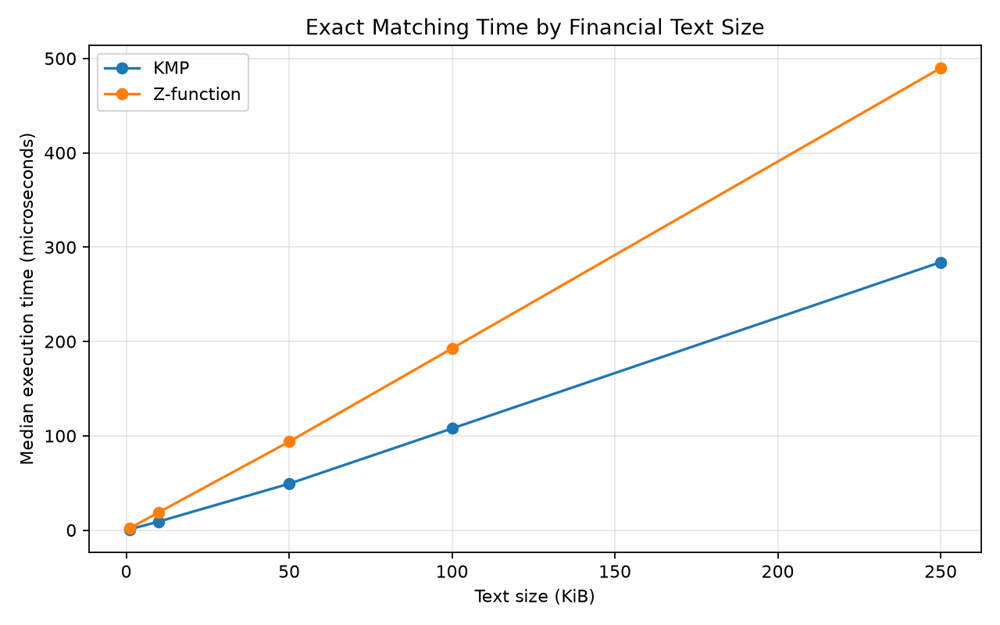
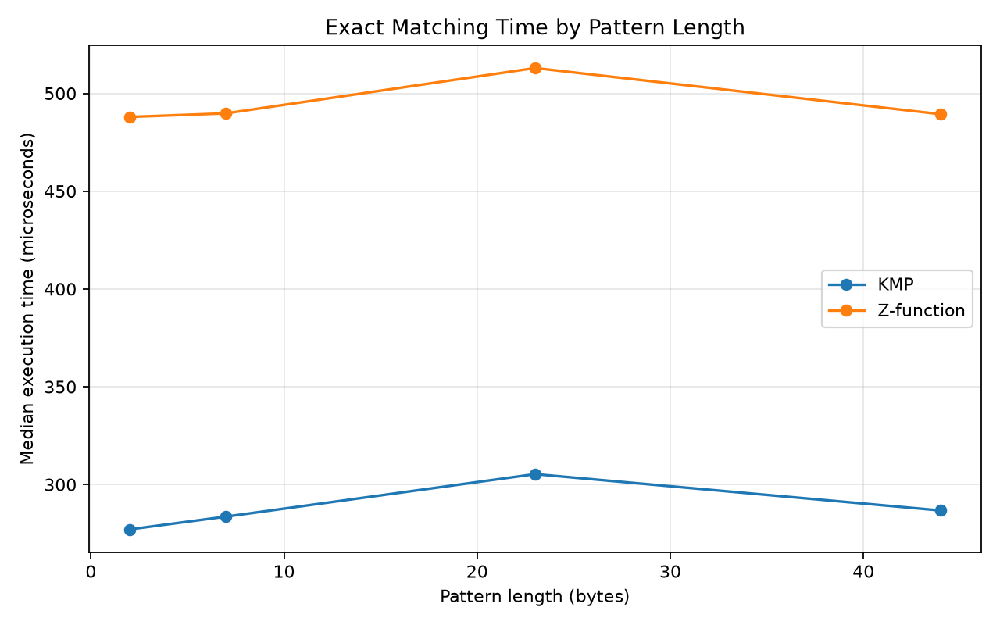
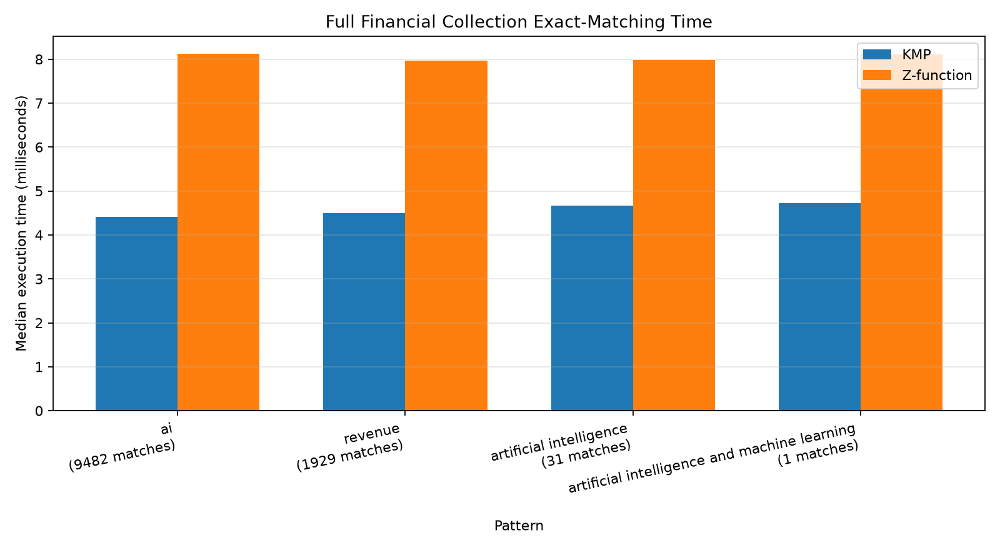

# Stage 3 Validation: Exact String Matching

## 1. Objectives

Stage 3 implemented, integrated, and evaluated two linear-time exact string-matching algorithms. The work adds custom C++17 Knuth-Morris-Pratt (KMP) and Z-function implementations, exposes them to Python through pybind11, searches normalized financial chunks, preserves UTF-8 byte offsets and overlapping matches, ranks chunks by exact occurrence count, and supports top-k and metadata filtering. It does not add approximate matching, semantic retrieval, or a language model.

The validation goals were to establish functional equivalence, preserve the Stage 2 Trie and inverted index, and compare end-to-end matcher costs under controlled synthetic and real financial workloads.

## 2. KMP Implementation

KMP preprocesses a pattern into its longest proper prefix that is also a suffix (LPS) table. At pattern position `i`, `LPS[i]` records the longest prefix length that can be retained after a mismatch. Search never moves the text cursor backward: it either advances after a match, falls back through LPS, or advances past an unmatched text byte. After a complete match, LPS fallback preserves overlaps.

The production functions are `computeLps`, `kmpSearch`, and `kmpCount`. For text length `n` and pattern length `m`, end-to-end matching takes `O(n + m)` time and `O(m)` auxiliary memory, excluding the `O(z)` returned positions for `z` matches.

## 3. Z-function Implementation

For every position `i`, the Z-array stores the length of the longest prefix also beginning at `i`; this project defines `Z[0] = 0`. The implementation maintains a known matching interval `[l, r)`. Values inside that interval reuse previously established prefix information, and new comparisons extend only beyond `r`.

Search constructs an integer sequence containing the pattern, separator value `256`, and text. Input bytes occupy `0..255`, so this separator cannot collide with punctuation, embedded NULs, byte 255, or UTF-8 bytes. The production functions are `computeZ`, `zSearch`, and `zCount`. Matching takes `O(n + m)` time and uses `O(n + m)` auxiliary memory for the combined sequence and Z-array, plus `O(z)` returned positions.

## 4. Search Integration Architecture

The `investment_engine` pybind11 extension calls both C++ implementations directly. Python `str` values are converted to length-aware UTF-8 `std::string` values; tests confirm embedded NUL preservation. Direct bindings compare bytes without normalization.

`SearchEngine.exact_phrase_search` normalizes queries with the existing NFKC, punctuation canonicalization, case-folding, and whitespace policy, then searches each stored `normalized_text`. Returned offsets are zero-based UTF-8 byte positions in that representation. Optional token-boundary filtering requires a result to begin and end on tokenizer boundaries.

For a canonical token phrase in boundary mode, the inverted index first supplies AND candidates over unique query tokens. Otherwise, a full scan prevents false negatives for punctuation and substrings inside larger tokens. This candidate selection is part of application retrieval but not part of the C++ algorithm benchmark.

## 5. Ranking and Filtering

Exact results use:

`score(chunk, query) = number of accepted exact phrase occurrences`

The score equals `match_count`, results sort by descending score and ascending chunk ID, and top-k is applied after sorting. Optional case-insensitive ticker and integer fiscal-year filters use stored metadata and are applied before exact matching. This strategy is separate from, and does not modify, Stage 2 term-frequency ranking.

## 6. Correctness Evaluation

The C++ tests cover basic and absent matches, repeated prefixes, overlaps, beginning/end positions, full-text equality, longer and empty patterns, punctuation, UTF-8 bytes, embedded NULs, separator safety, byte 255, and fixed-seed randomized KMP/Z comparisons. The Python tests cover bindings, normalization, boundary filtering, safe fallback, ranking, top-k, metadata, and real collection integration.

Before every timed benchmark case, the executable compares the complete position vector from KMP with the complete position vector from the Z-function for every fragment. All 17 cases passed, including no-match, one-match, multiple-match, overlapping, increasing-size, increasing-pattern-length, and real-collection cases. The benchmark therefore produced 34 algorithm result rows with no mismatch. The real SearchEngine demonstration also returned identical KMP and Z-function chunks, counts, offsets, and rankings.

Final regression verification passed 56/56 C++ tests and 83/83 Python tests. The Trie, inverted-index, KMP, Z-function, Python retrieval, and Python exact-search demonstrations all completed successfully. Hashes for all 48 files in the four data directories were unchanged during validation.

## 7. Benchmark Methodology

The benchmark executable uses the production `kmpSearch` and `zSearch` functions and `std::chrono::steady_clock`. Input construction, JSON parsing, collection loading, equivalence checks, and result-file output occur outside timed sections. Timed calls include all algorithm preprocessing, such as LPS construction or creation of the combined integer sequence and Z-array, as well as match-position construction.

Each case has three warm-ups. KMP-first and Z-first order alternates across warm-ups and measured repetitions to reduce ordering bias. A volatile checksum consumes match counts and positions so measured work remains observable. Depending on workload, cases use 11 to 301 repetitions. CSV and JSON retain median, mean, minimum, and maximum time in microseconds; conclusions use medians because occasional operating-system outliers affected some maxima.

The environment was:

- Apple M5 Pro, arm64.
- macOS 26.6.2.
- Apple Clang 21.0.0 (`clang-2100.3.34.2`).
- CMake 4.4.4, Release configuration.
- Python 3.14.7 and matplotlib 3.11.2 for visualization.
- Benchmark timestamp: 2026-10-19T15:59:01Z.

The normalized collection contains 2,458 chunks and 3,949,059 text bytes when chunk separators are excluded. Text-size and pattern-length cases use one concatenated financial-text prefix and report its exact bytes. Full-collection cases search 2,458 fragments separately, matching application-style per-chunk invocation but without index filtering. These two experiment types are not treated as interchangeable, and no index-filtered timing is compared with an unfiltered scan.

## 8. Benchmark Results

### Increasing financial-text size

All rows search for `revenue` in one normalized financial-text prefix.

| Text bytes | Matches | Repetitions | KMP median (µs) | Z median (µs) |
| ---: | ---: | ---: | ---: | ---: |
| 1,024 | 0 | 301 | 0.833 | 1.834 |
| 10,240 | 0 | 201 | 9.125 | 18.958 |
| 51,200 | 1 | 101 | 49.209 | 93.792 |
| 102,400 | 23 | 61 | 107.750 | 192.583 |
| 256,000 | 123 | 31 | 284.041 | 489.792 |

Both series grow approximately linearly over these input sizes, consistent with their theoretical bounds. The 1 KiB values are below two microseconds and are especially sensitive to timer and system noise.

### Pattern length on a 256,000-byte financial prefix

| Pattern | Bytes | Matches | KMP median (µs) | Z median (µs) |
| --- | ---: | ---: | ---: | ---: |
| `ai` | 2 | 677 | 277.042 | 487.958 |
| `revenue` | 7 | 123 | 283.584 | 489.792 |
| `artificial intelligence` | 23 | 2 | 305.291 | 512.959 |
| `artificial intelligence and machine learning` | 44 | 1 | 286.709 | 489.375 |

The text length dominates this range; timings do not increase monotonically with pattern length because comparisons and match distributions also change. The 23-byte case showed visible outliers (KMP maximum 627.083 µs and Z-function maximum 1,073.375 µs), so its medians are more representative than its means or maxima.

### Match distributions

| Scenario | Text bytes | Matches | KMP median (µs) | Z median (µs) |
| --- | ---: | ---: | ---: | ---: |
| No match | 102,400 | 0 | 77.625 | 167.000 |
| One inserted marker | 102,429 | 1 | 87.625 | 176.125 |
| Multiple `revenue` matches | 102,400 | 23 | 109.000 | 191.875 |
| Repetitive `a`, overlapping `aaaaa` | 102,400 | 102,396 | 113.583 | 430.041 |

The overlapping case measures construction of a very large returned position vector as part of both production searches. It is synthetic; the other three use normalized financial text, with one case containing a single inserted marker.

### Full real financial collection

Each repetition scans all 2,458 normalized chunks independently, totaling 3,949,059 bytes. Match counts are raw byte-substring occurrences without SearchEngine token-boundary filtering.

| Pattern | Bytes | Matches | Repetitions | KMP median (ms) | Z median (ms) |
| --- | ---: | ---: | ---: | ---: | ---: |
| `ai` | 2 | 9,482 | 11 | 4.404 | 8.122 |
| `revenue` | 7 | 1,929 | 11 | 4.503 | 7.961 |
| `artificial intelligence` | 23 | 31 | 11 | 4.667 | 7.977 |
| `artificial intelligence and machine learning` | 44 | 1 | 11 | 4.722 | 8.111 |

KMP had the lower median in all 17 cases on this machine. The measured Z/KMP median ratio ranged from approximately 1.68 to 3.79. The largest ratio occurred in the synthetic overlapping case. This is an observation about these implementations, compiler, machine, inputs, and allocation behavior—not a universal claim that one linear-time algorithm must always be faster.

Machine-readable results are stored in [exact_matching_results.csv](benchmarks/exact_matching_results.csv) and [exact_matching_summary.json](benchmarks/exact_matching_summary.json).

## 9. Complexity and Memory Comparison

Both algorithms have `O(n + m)` end-to-end time, but their auxiliary memory differs. KMP stores an `m`-entry LPS vector, so its theoretical auxiliary memory is `O(m)`. This Z-function implementation stores `n + m + 1` integer symbols and a same-length Z-array, so its theoretical auxiliary memory is `O(n + m)`. Both searches additionally return `O(z)` positions.

Asymptotic space does not specify actual bytes. Real consumption also depends on `std::size_t` and `unsigned int` widths, vector capacity, allocator bookkeeping, temporary objects, and returned-position capacity. No resident-set-size or peak-allocation instrumentation was used, so this report does not claim measured peak memory. The timing difference may partly reflect the Z implementation's larger allocations, but establishing a memory/time causal relationship would require dedicated profiling.

Across multiple fragments with lengths `n_i`, both implementations take `O(sum(n_i + m))` because preprocessing is repeated for each call. SearchEngine candidate selection can reduce the fragments examined, while metadata filtering costs `O(C)` for `C` candidates and ranking `M` matched chunks costs `O(M log M)`. Those application operations are outside the C++ timing loop.

## 10. Limitations

- Timings represent one machine, compiler, build, and run; background scheduling and thermal state can change results.
- Very small cases are noisy despite many repetitions.
- Medians describe latency, not throughput under concurrency.
- The benchmark does not measure pybind11, Python, indexing, JSON, disk I/O, or end-to-end UI latency.
- Full scans do not represent the faster index-filtered application path and are reported separately.
- Raw substring counts such as `ai` include occurrences inside larger tokens; SearchEngine boundary mode can return fewer matches.
- The benchmark returns all positions, so output allocation affects high-match cases.
- No empirical peak-memory measurement or Stage 6-scale performance analysis was performed.
- Exact occurrence frequency alone is not a semantic relevance score.

## 11. Conclusion

Stage 3 meets its correctness and integration objectives. KMP and the Z-function agree across the automated suites, randomized byte tests, 17 benchmark scenarios, and real financial queries. Both scale linearly in the tested size series. KMP was empirically faster in this run and uses lower theoretical auxiliary memory, while the Z-function remains a correct linear alternative and an instructive prefix-matching technique. Exact search, ranking, top-k, filtering, reproducible raw results, plots, and documentation are complete. Stage 3 is ready to be considered complete without beginning Stage 4.
