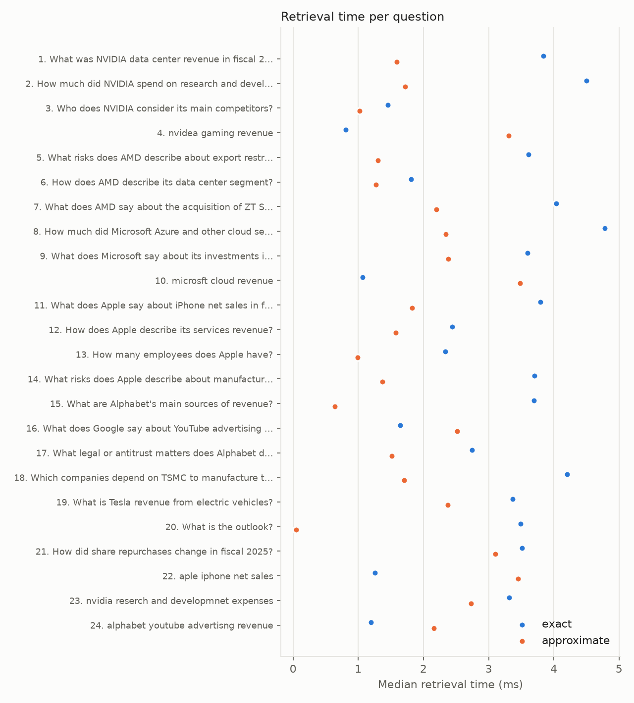
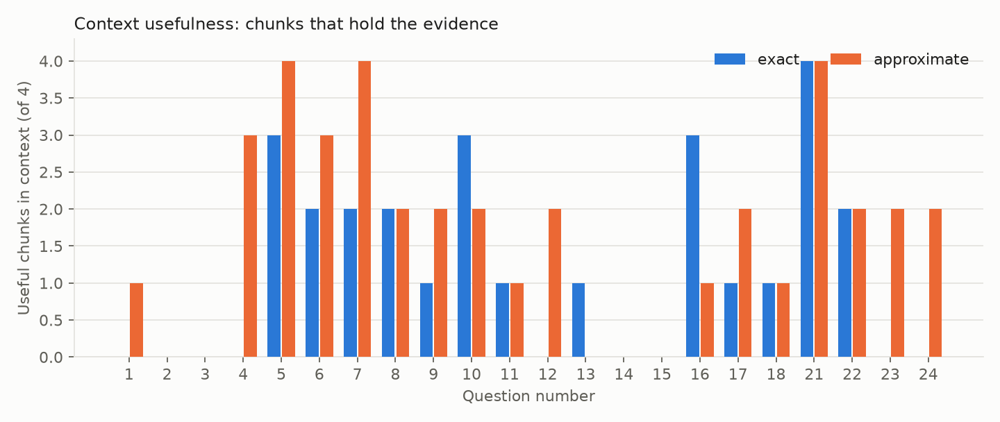
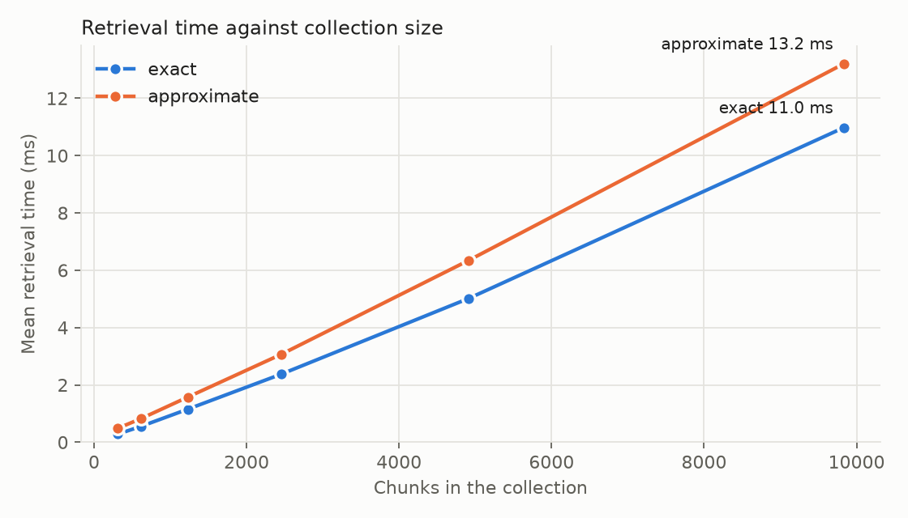

# Stage 6 results: exact vs approximate retrieval

24 questions, each run through both search modes with the same filters, context selection (at most 4 chunks, 1100 words, redundancy threshold 0.5) and model `Qwen/Qwen2.5-3B-Instruct` (greedy decoding). Retrieval time is the median of 7 runs after a warm up, in milliseconds on an Apple M4 Pro with a Release build. A chunk is *useful* when it is from the right filing and its text contains the evidence for the question (patterns listed at the end).

## Summary

| Measure | Exact | Approximate |
|---|---|---|
| Mean retrieval time (ms) | 2.92 | 1.94 |
| Median retrieval time (ms) | 3.43 | 1.77 |
| Slowest question (ms) | 4.78 | 3.48 |
| Mean candidate chunks examined | 681 | 357 |
| Mean chunks retrieved (top 10) | 10.0 | 10.0 |
| Mean chunks selected as context | 4.0 | 4.0 |
| Mean precision of context (useful / selected) | 0.30 | 0.43 |
| Mean generation time (ms) | 3135 | 3157 |
| Questions with a useful chunk in the top 10 | 16 of 22 | 18 of 22 |
| Questions with a useful chunk in the context | 13 of 22 | 17 of 22 |
| Answers: answered | 12 | 17 |
| Answers: correct | 2 | 3 |
| Answers: correct refusal | 1 | 1 |
| Answers: missed fact | 3 | 1 |
| Answers: refused | 6 | 2 |

Agreement: the two top 10 lists share on average 0.15 of their chunks (Jaccard of the ID sets), the selected contexts 0.14, and 0 of 24 questions got exactly the same context.

## Per question

| # | Question | Exact ms | Approx ms | Exact cand. | Approx cand. | Top 10 overlap | Useful in context (E / A) | Exact answer | Approx answer |
|---|---|---|---|---|---|---|---|---|---|
| 1 | What was NVIDIA data center revenue in fiscal 2025? | 3.84 | 1.59 | 264 | 223 | 0.11 | 0 / 1 | missed fact | correct |
| 2 | How much did NVIDIA spend on research and development in fiscal 2024? | 4.50 | 1.72 | 258 | 190 | 0.18 | 0 / 0 | missed fact | missed fact |
| 3 | Who does NVIDIA consider its main competitors? | 1.45 | 1.02 | 302 | 248 | 0.05 | 0 / 0 | refused | answered |
| 4 | nvidea gaming revenue | 0.81 | 3.31 | 607 | 762 | 0.00 | 0 / 3 | refused | answered |
| 5 | What risks does AMD describe about export restrictions to China? | 3.61 | 1.30 | 589 | 242 | 0.25 | 3 / 4 | answered | answered |
| 6 | How does AMD describe its data center segment? | 1.81 | 1.27 | 339 | 236 | 0.33 | 2 / 3 | answered | answered |
| 7 | What does AMD say about the acquisition of ZT Systems? | 4.04 | 2.20 | 592 | 401 | 0.11 | 2 / 4 | answered | answered |
| 8 | How much did Microsoft Azure and other cloud services revenue grow in fiscal 2025? | 4.78 | 2.35 | 235 | 223 | 0.54 | 2 / 2 | correct | correct |
| 9 | What does Microsoft say about its investments in artificial intelligence? | 3.60 | 2.38 | 497 | 406 | 0.00 | 1 / 2 | answered | answered |
| 10 | microsft cloud revenue | 1.06 | 3.48 | 728 | 820 | 0.43 | 3 / 2 | answered | answered |
| 11 | What does Apple say about iPhone net sales in fiscal 2025? | 3.79 | 1.82 | 154 | 144 | 0.43 | 1 / 1 | answered | answered |
| 12 | How does Apple describe its services revenue? | 2.44 | 1.57 | 286 | 226 | 0.05 | 0 / 2 | answered | answered |
| 13 | How many employees does Apple have? | 2.34 | 0.99 | 246 | 199 | 0.00 | 1 / 0 | correct | refused |
| 14 | What risks does Apple describe about manufacturing in China? | 3.70 | 1.37 | 305 | 226 | 0.00 | 0 / 0 | refused | refused |
| 15 | What are Alphabet's main sources of revenue? | 3.69 | 0.64 | 528 | 84 | 0.00 | 0 / 0 | refused | answered |
| 16 | What does Google say about YouTube advertising revenue? | 1.64 | 2.52 | 242 | 359 | 0.11 | 3 / 1 | answered | answered |
| 17 | What legal or antitrust matters does Alphabet describe? | 2.75 | 1.52 | 477 | 340 | 0.11 | 1 / 2 | answered | answered |
| 18 | Which companies depend on TSMC to manufacture their chips? | 4.21 | 1.70 | 2418 | 399 | 0.11 | 1 / 1 | answered | answered |
| 19 | What is Tesla revenue from electric vehicles? | 3.37 | 2.38 | 2040 | 536 | 0.00 | n/a | correct refusal | correct refusal |
| 20 | What is the outlook? | 3.49 | 0.05 | 2410 | 11 | 0.00 | n/a | refused | answered |
| 21 | How did share repurchases change in fiscal 2025? | 3.51 | 3.11 | 1186 | 721 | 0.18 | 4 / 4 | answered | answered |
| 22 | aple iphone net sales | 1.25 | 3.45 | 805 | 905 | 0.43 | 2 / 2 | answered | answered |
| 23 | nvidia reserch and developmnet expenses | 3.31 | 2.73 | 521 | 320 | 0.11 | 0 / 2 | missed fact | correct |
| 24 | alphabet youtube advertisng revenue | 1.19 | 2.16 | 322 | 346 | 0.00 | 0 / 2 | refused | answered |

## Collection size

Both searches timed without filters on the 24 questions, on every 8th, 4th and 2nd chunk of the collection, the full collection, and 2 and 4 renamed copies of it. Times are the mean over questions of the median of 3 runs.

| Chunks | Exact ms | Approx ms | Exact candidates | Approx candidates |
|---|---|---|---|---|
| 308 | 0.28 | 0.48 | 232 | 125 |
| 615 | 0.55 | 0.82 | 463 | 248 |
| 1,229 | 1.15 | 1.57 | 929 | 496 |
| 2,458 | 2.38 | 3.07 | 1854 | 985 |
| 4,916 | 5.02 | 6.35 | 3708 | 1971 |
| 9,832 | 10.97 | 13.20 | 7416 | 3942 |

## Answers side by side

### 1. What was NVIDIA data center revenue in fiscal 2025?

Filters: ticker `NVDA`, fiscal year `2025`. Evidence chunks in the collection: 1.

**Approximate** (1.59 ms, 223 candidates, verdict: correct). Context: `NVDA_2025_10K_0255` (useful), `NVDA_2025_10K_0144`, `NVDA_2025_10K_0256`, `NVDA_2025_10K_0154`

> [1] NVIDIA data center revenue in fiscal 2025 was $115,186 million.

**Exact** (3.84 ms, 264 candidates, verdict: missed fact). Context: `NVDA_2025_10K_0154`, `NVDA_2025_10K_0233`, `NVDA_2025_10K_0145`, `NVDA_2025_10K_0165`

> [1] NVIDIA Corporation's data center revenue for fiscal year 2025 was up 142% from a year ago. [1]

### 2. How much did NVIDIA spend on research and development in fiscal 2024?

Filters: ticker `NVDA`, fiscal year `2024`. Evidence chunks in the collection: 3.

**Approximate** (1.72 ms, 190 candidates, verdict: missed fact). Context: `NVDA_2024_10K_0212`, `NVDA_2024_10K_0219`, `NVDA_2024_10K_0233`, `NVDA_2024_10K_0228`

> [1] NVIDIA spent $2,532 million on research and development in fiscal 2024.

**Exact** (4.50 ms, 258 candidates, verdict: missed fact). Context: `NVDA_2024_10K_0227`, `NVDA_2024_10K_0147`, `NVDA_2024_10K_0005`, `NVDA_2024_10K_0038`

> [NVIDIA Corporation (NVDA) 10-K, fiscal year 2024] The Compensation Committee of our Board of Directors assists in the oversight of policies and strategies relating to human capital management. [1] Research and development employees made up 22,200 out of 29,600 total employees, indicating that 75% of the workforce was involved in research and development. [1]

### 3. Who does NVIDIA consider its main competitors?

Filters: ticker `NVDA`, fiscal year `None`. Evidence chunks in the collection: 2.

**Approximate** (1.02 ms, 248 candidates, verdict: answered). Context: `NVDA_2024_10K_0102`, `NVDA_2024_10K_0107`, `NVDA_2025_10K_0115`, `NVDA_2025_10K_0157`

> NVIDIA considers its competitors as those who sell products that are not subject to the new restrictions or may be able to acquire licenses for their products [2].

**Exact** (1.45 ms, 302 candidates, verdict: refused). Context: `NVDA_2025_10K_0005`, `NVDA_2024_10K_0006`, `NVDA_2024_10K_0008`, `NVDA_2024_10K_0017`

> The provided filings do not contain this information.

### 4. nvidea gaming revenue

*Why this question:* typo in the company name.

Filters: ticker `None`, fiscal year `None`. Evidence chunks in the collection: 7.

**Approximate** (3.31 ms, 762 candidates, verdict: answered). Context: `NVDA_2024_10K_0146` (useful), `NVDA_2024_10K_0147` (useful), `NVDA_2024_10K_0145` (useful), `NVDA_2024_10K_0156`

> Gaming revenue for fiscal year 2024 was $10.4 billion, up 15% from fiscal year 2023 [2].

**Exact** (0.81 ms, 607 candidates, verdict: refused). Context: `AMD_2024_10K_0170`, `AMD_2025_10K_0178`, `AMD_2024_10K_0156`, `MSFT_2025_10K_0105`

> The provided filings do not contain this information.

### 5. What risks does AMD describe about export restrictions to China?

Filters: ticker `AMD`, fiscal year `None`. Evidence chunks in the collection: 16.

**Approximate** (1.30 ms, 242 candidates, verdict: answered). Context: `AMD_2025_10K_0167` (useful), `AMD_2025_10K_0107` (useful), `AMD_2024_10K_0106` (useful), `AMD_2025_10K_0106` (useful)

> AMD describes risks associated with export restrictions to China in [1], [2], and [3]. These risks include limitations on selling certain products or technologies to China, potential delays in shipments due to licensing requirements, and the possibility of losing sales if new products are deemed subject to licensing requirements. Additionally, evolving U.S. government policy towards semiconductor exports could adversely affect AMD's business. [1]

**Exact** (3.61 ms, 589 candidates, verdict: answered). Context: `AMD_2025_10K_0113` (useful), `AMD_2025_10K_0107` (useful), `AMD_2024_10K_0107` (useful), `AMD_2025_10K_0027`

> AMD describes export restrictions to China as posing a threat to its ability to sell certain products or technologies in these markets or to certain customers [2]. These restrictions can limit the company's ability to ship certain AMD products to China or to customers outside the US who are headquartered in or have an ultimate parent headquartered in a country designated as a D5 Country [2]. This could lead to lost sales and potentially harm the company's reputation and business [2]. Additionally, the restrictions can make it easier for competitors in China to develop and sell their own solutions, reducing the demand for AMD products [2].

### 6. How does AMD describe its data center segment?

Filters: ticker `AMD`, fiscal year `None`. Evidence chunks in the collection: 28.

**Approximate** (1.27 ms, 236 candidates, verdict: answered). Context: `AMD_2025_10K_0161`, `AMD_2025_10K_0228` (useful), `AMD_2024_10K_0156` (useful), `AMD_2024_10K_0012` (useful)

> AMD describes its data center segment as driving strong revenue growth with net revenue increasing 14% to $25.8 billion in 2024 [3], and further increasing by 32% to $16.6 billion in 2025 [1]. The segment's growth was primarily driven by higher sales of AMD Instinct™ GPUs and AMD EPYC™ CPUs in 2024 [3] and 5th generation AMD EPYC™ processors in 2025 [1].

**Exact** (1.81 ms, 339 candidates, verdict: answered). Context: `AMD_2024_10K_0015` (useful), `AMD_2024_10K_0014` (useful), `AMD_2025_10K_0027`, `AMD_2025_10K_0015`

> AMD describes its data center segment as primarily including server-class CPUs, GPUs, AI accelerators, DPUs, FPGAs, SmartNICs, and Adaptive SoC products for data centers [1]. It also mentions that the Data Center segment primarily includes AI accelerators, server CPUs, GPUs, APUs, DPUs, FPGAs, SmartNICs, and Adaptive SoC products [2].

### 7. What does AMD say about the acquisition of ZT Systems?

Filters: ticker `AMD`, fiscal year `None`. Evidence chunks in the collection: 22.

**Approximate** (2.20 ms, 401 candidates, verdict: answered). Context: `AMD_2024_10K_0008` (useful), `AMD_2025_10K_0139` (useful), `AMD_2025_10K_0228` (useful), `AMD_2024_10K_0013` (useful)

> AMD intends to seek a strategic partner to acquire ZT Systems' manufacturing business [2]. Additionally, the acquisition of ZT Systems is expected to close in the first half of fiscal year 2025, subject to certain regulatory approvals and other customary closing conditions [4].

**Exact** (4.04 ms, 592 candidates, verdict: answered). Context: `AMD_2025_10K_0238`, `AMD_2025_10K_0227`, `AMD_2025_10K_0228` (useful), `AMD_2024_10K_0137` (useful)

> AMD says the acquisition of ZT Systems is expected to occur in the first half of 2025 [4]. It is subject to the satisfaction or waiver of a number of customary conditions as specified in the purchase agreement, including receipt of certain specified required regulatory approvals and the absence of laws or orders restraining the consummation of the Agreement [4]. Any delay in completing the Acquisition could cause AMD to not realize, or to be delayed in realizing, some or all of the benefits they expect to achieve from this transaction [4].

### 8. How much did Microsoft Azure and other cloud services revenue grow in fiscal 2025?

Filters: ticker `MSFT`, fiscal year `2025`. Evidence chunks in the collection: 3.

**Approximate** (2.35 ms, 223 candidates, verdict: correct). Context: `MSFT_2025_10K_0113`, `MSFT_2025_10K_0105` (useful), `MSFT_2025_10K_0208`, `MSFT_2025_10K_0116` (useful)

> Microsoft Azure and other cloud services revenue grew 34% in fiscal 2025 [1].

**Exact** (4.78 ms, 235 candidates, verdict: correct). Context: `MSFT_2025_10K_0112` (useful), `MSFT_2025_10K_0105` (useful), `MSFT_2025_10K_0205`, `MSFT_2025_10K_0111`

> [4] Server products and cloud services revenue increased 23% driven by Azure and other cloud services revenue growth of 34%. [4]

### 9. What does Microsoft say about its investments in artificial intelligence?

Filters: ticker `MSFT`, fiscal year `None`. Evidence chunks in the collection: 41.

**Approximate** (2.38 ms, 406 candidates, verdict: answered). Context: `MSFT_2024_10K_0122` (useful), `MSFT_2024_10K_0060` (useful), `MSFT_2024_10K_0203`, `MSFT_2024_10K_0006`

> Microsoft invests in artificial intelligence across the entire company and infuses generative AI capabilities into its consumer and commercial offerings [2].

**Exact** (3.60 ms, 497 candidates, verdict: answered). Context: `MSFT_2025_10K_0115`, `MSFT_2025_10K_0116` (useful), `MSFT_2025_10K_0170`, `MSFT_2024_10K_0191`

> Microsoft says the gross margin percentage decreased slightly primarily driven by the impact of scaling their AI infrastructure, offset in part by efficiency gains in Microsoft 365 Commercial cloud [1].

### 10. microsft cloud revenue

*Why this question:* typo in the company name.

Filters: ticker `None`, fiscal year `None`. Evidence chunks in the collection: 8.

**Approximate** (3.48 ms, 820 candidates, verdict: answered). Context: `MSFT_2024_10K_0129` (useful), `MSFT_2025_10K_0113`, `MSFT_2024_10K_0123` (useful), `MSFT_2025_10K_0114`

> Microsoft Cloud revenue increased 23% to $137.4 billion in fiscal year 2024 [3]. In fiscal year 2025, Microsoft Cloud revenue increased 21% to $106,265 million [4].

**Exact** (1.06 ms, 728 candidates, verdict: answered). Context: `MSFT_2024_10K_0129` (useful), `MSFT_2025_10K_0105` (useful), `MSFT_2025_10K_0112`, `MSFT_2024_10K_0123` (useful)

> Microsoft Cloud revenue increased 23% to $168.9 billion [2].

### 11. What does Apple say about iPhone net sales in fiscal 2025?

Filters: ticker `AAPL`, fiscal year `2025`. Evidence chunks in the collection: 1.

**Approximate** (1.82 ms, 144 candidates, verdict: answered). Context: `AAPL_2025_10K_0084` (useful), `AAPL_2025_10K_0083`, `AAPL_2025_10K_0108`, `AAPL_2025_10K_0107`

> Apple says iPhone net sales increased during 2025 compared to 2024 primarily due to higher net sales of Pro models [1].

**Exact** (3.79 ms, 154 candidates, verdict: answered). Context: `AAPL_2025_10K_0083`, `AAPL_2025_10K_0084` (useful), `AAPL_2025_10K_0107`, `AAPL_2025_10K_0097`

> Apple says iPhone net sales increased during 2025 compared to 2024 due to higher net sales of Pro models [2].

### 12. How does Apple describe its services revenue?

Filters: ticker `AAPL`, fiscal year `None`. Evidence chunks in the collection: 8.

**Approximate** (1.57 ms, 226 candidates, verdict: answered). Context: `AAPL_2024_10K_0039`, `AAPL_2024_10K_0103` (useful), `AAPL_2024_10K_0100` (useful), `AAPL_2024_10K_0060`

> Apple describes its services revenue as recognizing revenue at the amount to which it expects to be entitled when control of the products or services is transferred to its customers [3]. Services net sales include amortization of the deferred value of services bundled in the sales price of certain products [2]. Services net sales are disaggregated by significant products and services for 2024, 2023, and 2022, showing figures for iPhone, Mac, iPad, Wearables, Home and Accessories, and Services [2]. Revenue from services is recognized over time as services are delivered [3].

**Exact** (2.44 ms, 286 candidates, verdict: answered). Context: `AAPL_2024_10K_0008`, `AAPL_2024_10K_0102`, `AAPL_2024_10K_0009`, `AAPL_2024_10K_0044`

> Apple describes its services revenue as being derived from third-party licensing arrangements and its own advertising platforms [1]. Services revenue is allocated to all performance obligations based on their relative standalone selling prices [2]. Revenue allocated to the delivered hardware and bundled software is recognized when control transfers to the customer, typically upon shipment [2]. For product-related bundled services, revenue is deferred and recognized on a straight-line basis over the estimated period they are expected to be provided [2]. For long-term service arrangements, if the Company has performance obligations for undelivered services, it does not recognize revenue related to these undelivered services since they relate entirely to the value of the undelivered services [2]. Revenue from the sale of third-party products where the Company obtains control of the product before transferring it to the customer is recognized based on the gross amount billed to customers [2].

### 13. How many employees does Apple have?

*Why this question:* the filing says 'the Company', not 'Apple'.

Filters: ticker `AAPL`, fiscal year `None`. Evidence chunks in the collection: 2.

**Approximate** (0.99 ms, 199 candidates, verdict: refused). Context: `AAPL_2025_10K_0043`, `AAPL_2025_10K_0047`, `AAPL_2025_10K_0120`, `AAPL_2024_10K_0021`

> The provided filings do not contain this information. [1]

**Exact** (2.34 ms, 246 candidates, verdict: correct). Context: `AAPL_2024_10K_0008`, `AAPL_2024_10K_0009`, `AAPL_2025_10K_0081`, `AAPL_2024_10K_0016` (useful)

> Apple has approximately 164,000 full-time equivalent employees [4].

### 14. What risks does Apple describe about manufacturing in China?

Filters: ticker `AAPL`, fiscal year `None`. Evidence chunks in the collection: 7.

**Approximate** (1.37 ms, 226 candidates, verdict: refused). Context: `AAPL_2024_10K_0065`, `AAPL_2025_10K_0034`, `AAPL_2025_10K_0035`, `AAPL_2024_10K_0064`

> The provided filings do not contain this information. [1]

**Exact** (3.70 ms, 305 candidates, verdict: refused). Context: `AAPL_2025_10K_0112`, `AAPL_2024_10K_0094`, `AAPL_2025_10K_0019`, `AAPL_2024_10K_0009`

> The provided filings do not contain this information.

### 15. What are Alphabet's main sources of revenue?

Filters: ticker `GOOGL`, fiscal year `None`. Evidence chunks in the collection: 6.

**Approximate** (0.64 ms, 84 candidates, verdict: answered). Context: `GOOGL_2025_10K_0184`, `GOOGL_2024_10K_0008`, `GOOGL_2024_10K_0025`, `GOOGL_2025_10K_0119`

> Alphabet's main sources of revenue include Google Cloud and Google subscriptions, platforms, and devices [1]. Revenue from TAC (Transaction Advertising Cost) increased significantly from 2024 to 2025, contributing to overall cost of revenues [4]. Other cost of revenues also saw an increase, primarily due to content acquisition costs, depreciation expense, and other technical infrastructure operations costs [4].

**Exact** (3.69 ms, 528 candidates, verdict: refused). Context: `GOOGL_2024_10K_0236`, `GOOGL_2025_10K_0129`, `GOOGL_2025_10K_0194`, `GOOGL_2024_10K_0165`

> The provided filings do not contain this information.

### 16. What does Google say about YouTube advertising revenue?

Filters: ticker `GOOGL`, fiscal year `None`. Evidence chunks in the collection: 9.

**Approximate** (2.52 ms, 359 candidates, verdict: answered). Context: `GOOGL_2024_10K_0114` (useful), `GOOGL_2024_10K_0172`, `GOOGL_2024_10K_0116`, `GOOGL_2024_10K_0043`

> YouTube advertising revenue is part of Google's Google advertising revenues, which include revenues generated on YouTube properties [2].

**Exact** (1.64 ms, 242 candidates, verdict: answered). Context: `GOOGL_2025_10K_0160`, `GOOGL_2024_10K_0114` (useful), `GOOGL_2024_10K_0124` (useful), `GOOGL_2024_10K_0115` (useful)

> YouTube ads revenues increased $4.6 billion from 2023 to 2024 [2]. YouTube ads revenues increased due to increased spending by advertisers on brand advertising products and direct response advertising products [2].

### 17. What legal or antitrust matters does Alphabet describe?

Filters: ticker `GOOGL`, fiscal year `None`. Evidence chunks in the collection: 17.

**Approximate** (1.52 ms, 340 candidates, verdict: answered). Context: `GOOGL_2024_10K_0225` (useful), `GOOGL_2025_10K_0071` (useful), `GOOGL_2025_10K_0120`, `GOOGL_2025_10K_0150`

> Alphabet describes antitrust matters including formal and informal inquiries and investigations by regulatory authorities and private parties in the U.S., Europe, and other jurisdictions globally [1]. Specifically, it mentions a € 2.4 billion fine imposed by the EC for certain actions taken by Google relating to its display and ranking of shopping search results and ads infringing European antitrust laws [1]. Additionally, it is subject to antitrust lawsuits about aspects of its business, including its advertising technologies and practices, the operation and distribution of Google Search, and the operation and distribution of Android operating system and Play Store [2].

**Exact** (2.75 ms, 477 candidates, verdict: answered). Context: `GOOGL_2024_10K_0225` (useful), `GOOGL_2024_10K_0264`, `GOOGL_2024_10K_0063`, `GOOGL_2025_10K_0060`

> Alphabet describes antitrust matters involving Shopping where in June 2017, the EC announced a € 2.4 billion fine for certain actions taken by Google relating to its display and ranking of shopping search results and ads, infringing European antitrust laws [1].

### 18. Which companies depend on TSMC to manufacture their chips?

*Why this question:* no company filter, cross filing.

Filters: ticker `None`, fiscal year `None`. Evidence chunks in the collection: 13.

**Approximate** (1.70 ms, 399 candidates, verdict: answered). Context: `AMD_2025_10K_0073` (useful), `AMD_2024_10K_0091`, `AMD_2025_10K_0092`, `GOOGL_2025_10K_0041`

> TSMC manufactures chips for AMD [1]. TSMC also manufactures chips for other companies, including certain of AMD's competitors [1].

**Exact** (4.21 ms, 2418 candidates, verdict: answered). Context: `AMD_2025_10K_0073` (useful), `NVDA_2025_10K_0072`, `AMD_2024_10K_0091`, `AMD_2024_10K_0092`

> TSMC manufactures chips for AMD [1]. TSMC manufactures chips for NVIDIA [2].

### 19. What is Tesla revenue from electric vehicles?

*Why this question:* out of corpus: no Tesla filing.

Filters: ticker `None`, fiscal year `None`. Evidence chunks in the collection: none.

**Approximate** (2.38 ms, 536 candidates, verdict: correct refusal). Context: `NVDA_2024_10K_0148`, `NVDA_2025_10K_0026`, `NVDA_2025_10K_0251`, `NVDA_2025_10K_0252`

> The provided filings do not contain this information.

**Exact** (3.37 ms, 2040 candidates, verdict: correct refusal). Context: `NVDA_2025_10K_0164`, `MSFT_2025_10K_0105`, `MSFT_2025_10K_0112`, `NVDA_2024_10K_0191`

> The provided filings do not contain this information.

### 20. What is the outlook?

*Why this question:* vague question.

Filters: ticker `None`, fiscal year `None`. Evidence chunks in the collection: none.

**Approximate** (0.05 ms, 11 candidates, verdict: answered). Context: `MSFT_2025_10K_0013`, `MSFT_2025_10K_0134`, `MSFT_2024_10K_0181`, `MSFT_2024_10K_0153`

> The outlook is evaluated through a systematic methodology considering available quantitative and qualitative evidence in evaluating potential impairment of investments [1]. Judgment is applied to assess the pattern of delivery for the SA program, requiring significant judgment due to the benefits and nature of the program [1]. Impairment of investment securities is reviewed quarterly for credit losses and impairment, with a systematic methodology employed to evaluate potential impairment [1]. The judgment involved in assessing the pattern of delivery for the SA program and the evaluation of potential impairment of investments require significant judgment [1].

**Exact** (3.49 ms, 2410 candidates, verdict: refused). Context: `AAPL_2025_10K_0105`, `AAPL_2025_10K_0106`, `AMD_2024_10K_0206`, `AMD_2024_10K_0194`

> The provided filings do not contain this information.

### 21. How did share repurchases change in fiscal 2025?

*Why this question:* fiscal year filter but no company.

Filters: ticker `None`, fiscal year `2025`. Evidence chunks in the collection: 70.

**Approximate** (3.11 ms, 721 candidates, verdict: answered). Context: `MSFT_2025_10K_0103` (useful), `MSFT_2025_10K_0102` (useful), `MSFT_2025_10K_0129` (useful), `NVDA_2025_10K_0170` (useful)

> Microsoft Corporation's share repurchases increased from $12.0 billion in fiscal year 2024 to $13.0 billion in fiscal year 2025 [2].

**Exact** (3.51 ms, 1186 candidates, verdict: answered). Context: `MSFT_2025_10K_0102` (useful), `MSFT_2025_10K_0197` (useful), `MSFT_2025_10K_0198` (useful), `GOOGL_2025_10K_0225` (useful)

> Share repurchases increased significantly in fiscal 2025 compared to previous years [1]. In 2025, Microsoft repurchased 13,000 million shares worth $9.4 billion in total, while in 2024 they repurchased 11,960 million shares worth $8.5 billion [2]. In 2023, they repurchased 18,400 million shares worth $15.2 billion [3]. This indicates a substantial increase in share repurchases in fiscal 2025.

### 22. aple iphone net sales

*Why this question:* typo in the company name.

Filters: ticker `None`, fiscal year `None`. Evidence chunks in the collection: 2.

**Approximate** (3.45 ms, 905 candidates, verdict: answered). Context: `AAPL_2025_10K_0084` (useful), `AAPL_2024_10K_0082` (useful), `AAPL_2024_10K_0081`, `AAPL_2025_10K_0083`

> Apple iPhone net sales increased during 2025 compared to 2024 primarily due to higher net sales of Pro models [1].

**Exact** (1.25 ms, 805 candidates, verdict: answered). Context: `AAPL_2024_10K_0081`, `AAPL_2025_10K_0083`, `AAPL_2025_10K_0084` (useful), `AAPL_2024_10K_0082` (useful)

> Apple iPhone net sales increased during 2025 compared to 2024 due to higher net sales of Pro models [3].

### 23. nvidia reserch and developmnet expenses

*Why this question:* two typos in the topic words.

Filters: ticker `NVDA`, fiscal year `None`. Evidence chunks in the collection: 6.

**Approximate** (2.73 ms, 320 candidates, verdict: correct). Context: `NVDA_2024_10K_0184` (useful), `NVDA_2024_10K_0183` (useful), `NVDA_2024_10K_0052`, `NVDA_2024_10K_0051`

> [1] NVIDIA Corporation's research and development expenses for the fiscal year ending January 28, 2024 were $8,675 million. For the fiscal year ending January 29, 2023, it was $7,339 million. For the fiscal year ending January 30, 2022, it was $5,268 million.

**Exact** (3.31 ms, 521 candidates, verdict: missed fact). Context: `NVDA_2025_10K_0005`, `NVDA_2025_10K_0055`, `NVDA_2025_10K_0264`, `NVDA_2024_10K_0019`

> [1] NVIDIA Corporation discloses market risk disclosures in its 10-K filing for fiscal year 2025. [1] Research and development expenses are not directly disclosed in the given 10-K filing for fiscal year 2025.

### 24. alphabet youtube advertisng revenue

*Why this question:* typo in a topic word.

Filters: ticker `GOOGL`, fiscal year `None`. Evidence chunks in the collection: 9.

**Approximate** (2.16 ms, 346 candidates, verdict: answered). Context: `GOOGL_2025_10K_0107` (useful), `GOOGL_2025_10K_0125`, `GOOGL_2025_10K_0110`, `GOOGL_2025_10K_0117` (useful)

> YouTube ads revenues increased $4.2 billion from 2024 to 2025 [4].

**Exact** (1.19 ms, 322 candidates, verdict: refused). Context: `GOOGL_2024_10K_0264`, `GOOGL_2025_10K_0258`, `GOOGL_2024_10K_0196`, `GOOGL_2024_10K_0105`

> The provided filings do not contain this information.

## Evidence patterns

| Question | Ticker | Year | Patterns (all must match) |
|---|---|---|---|
| What was NVIDIA data center revenue in fiscal 2025? | NVDA | any | `115,186` |
| How much did NVIDIA spend on research and development in fiscal 2024? | NVDA | 2024 | `research and development` and `8,675` |
| Who does NVIDIA consider its main competitors? | NVDA | any | `competitors` and `\bAMD\b\|Intel\|Broadcom` |
| nvidea gaming revenue | NVDA | any | `gaming revenue` |
| What risks does AMD describe about export restrictions to China? | AMD | any | `export` and `china` |
| How does AMD describe its data center segment? | AMD | any | `data center segment` |
| What does AMD say about the acquisition of ZT Systems? | AMD | any | `zt systems` |
| How much did Microsoft Azure and other cloud services revenue grow in fiscal 2025? | MSFT | 2025 | `azure and other cloud services revenue` |
| What does Microsoft say about its investments in artificial intelligence? | MSFT | any | `artificial intelligence\|\bAI\b` and `invest` |
| microsft cloud revenue | MSFT | any | `microsoft cloud revenue` |
| What does Apple say about iPhone net sales in fiscal 2025? | AAPL | 2025 | `iphone net sales` |
| How does Apple describe its services revenue? | AAPL | any | `services net sales` |
| How many employees does Apple have? | AAPL | any | `full-time equivalent employees` |
| What risks does Apple describe about manufacturing in China? | AAPL | any | `china` and `manufactur\|outsourcing partner` |
| What are Alphabet's main sources of revenue? | GOOGL | any | `google advertising` and `google cloud` |
| What does Google say about YouTube advertising revenue? | GOOGL | any | `youtube ads` |
| What legal or antitrust matters does Alphabet describe? | GOOGL | any | `antitrust\|competition law` |
| Which companies depend on TSMC to manufacture their chips? | any | any | `tsmc\|taiwan semiconductor` |
| How did share repurchases change in fiscal 2025? | any | 2025 | `repurchase` |
| aple iphone net sales | AAPL | any | `iphone net sales` |
| nvidia reserch and developmnet expenses | NVDA | any | `research and development` and `8,675\|12,914` |
| alphabet youtube advertisng revenue | GOOGL | any | `youtube ads` |
